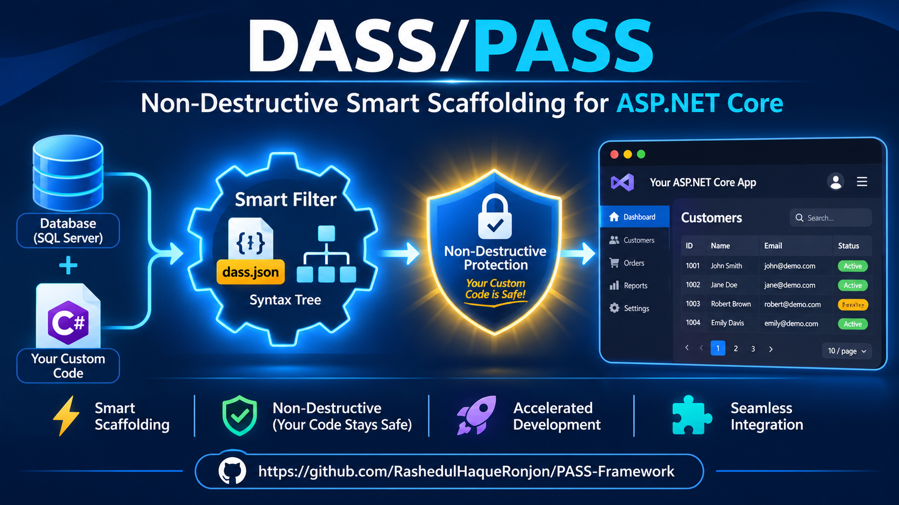

# PASS: Project Aware Smart Scaffolder

**PASS** is a proposed deterministic, database-aware, project-aware, and logic-aware scaffolding framework for ASP.NET Core MVC. It is designed to extend—not replace—Microsoft’s existing scaffolding capabilities.

> **Current Phase: Research & RFC (Request for Comments).** 
> We are currently documenting the architecture, writing the research proposal, and seeking feedback from the .NET community before writing the source code.

## 🛑 The Problem: The "Scaffolding Paradox"
Microsoft's default scaffolding is excellent for the first generation of code. However, in real-world iterative development, scaffolding is destructive. If your database schema changes, re-running the default scaffolder **overwrites your custom business logic, UI adjustments, and manual edits**. This forces developers to either manually update files or abandon scaffolding entirely.

## 💡 The Solution: PASS
DASS sits alongside Microsoft's scaffolder. It introduces **Project Memory** and **Safe Regeneration**:
1. **Project Memory (`pass.json`)**: Remembers your UI/UX conventions (Dark mode, Syncfusion, pagination, etc.) and applies them to all future scaffolds.
2. **Roslyn Merging**: Instead of overwriting `Customer.cs`, PASS uses Abstract Syntax Trees (AST) to inject *only* the new database properties (e.g., `Email`, `Status`) while preserving your custom methods like `CalculateLoyaltyPoints()`.

## 📚 Explore the Blueprint
To understand the vision, please read the following documents:
* [Research Proposal](docs/research/ResearchProposal.md)
* [Methodology & Evaluation Plan](docs/research/Methodology.md)
* [System Architecture](docs/architecture/SystemArchitecture.md)
* [Roslyn Merging Strategy](docs/architecture/Roslyn_Merging.md)
* [RFC-0001: Community Discussion](docs/rfc/RFC-0001-DASS.md)

## 🤝 How to Contribute Right Now
You don't need to write C# code to help yet. We need **architects, senior .NET developers, and researchers** to review our blueprints. 
1. Read the [Discussion Topics](docs/rfc/DiscussionTopics.md).
2. Open an [Issue](https://github.com/RashedulHaqueRonjon/PASS-Framework/issues) with your feedback.
3. Share this repository with other .NET developers.

## 📄 License
This project is licensed under the Apache License 2.0 - see the [LICENSE](LICENSE) file for details.
