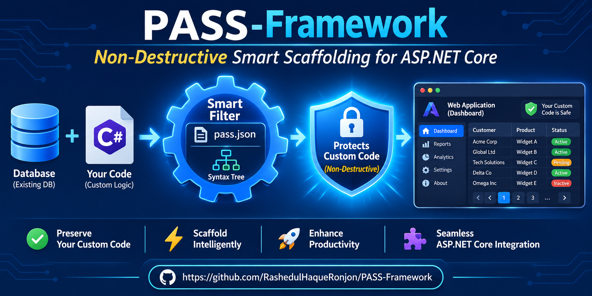
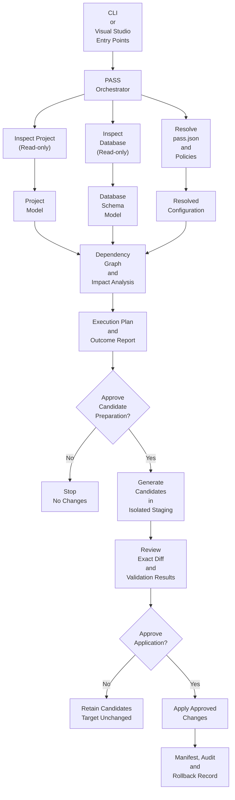

# PASS — Project Aware Smart Scaffolder

 

**PASS (Project Aware Smart Scaffolder)** is a proposed, deterministic, database-aware and project-aware scaffolding and change-reconciliation framework for database-first ASP.NET Core MVC applications. PASS is intended to complement—not replace—Microsoft's existing tooling.

> **Project status: conceptual research and RFC phase.** The architecture, requirements, workflows and evaluation plan are being specified. The PASS engine, CLI, VSIX, sample applications and automated tests have not yet been implemented. Diagrams and screenshots are illustrative evidence/prototypes, not proof of a currently available executable PASS product.

## The problem PASS investigates

Scaffolding can accelerate initial application development, but maintaining generated artifacts as a project evolves involves more than regenerating an entity class. A database change can affect entity models, `DbContext` mappings, view models, controllers, Razor views, JavaScript/AJAX contracts, tests, package dependencies and project configuration. Existing developer customizations and project conventions must also be considered.

PASS proposes a project-level mechanism for remembering approved conventions, identifying the impact of a proposed change across dependent artifacts, preparing a reviewable execution plan and reconciling generated output without silently replacing developer work.

This proposal does **not** assume that every Microsoft scaffolding operation overwrites custom code. EF Core already supports partial classes, partial model-configuration hooks and T4 customization. PASS intends to build on such facilities and investigate the broader cross-artifact lifecycle and approval problem. See [Research Proposal](docs/research/ResearchProposal.md) and [References](docs/research/References.md).

## Core principles

1. **Remember the project.** Keep shared, version-controlled project conventions in `pass.json`; keep personal preferences and secrets separate.
2. **Understand dependencies.** Analyse database schema, project structure, application conventions, code and generation history.
3. **Plan before generating.** Perform read-only inspection and produce a probable-outcome/impact report before candidate code generation.
4. **Require explicit approval.** Candidate generation and application of changes are separate, approval-gated operations. No silent changes, including apparently insignificant changes.
5. **Protect developer work.** Track generated-artifact ownership and baselines; stop and report ambiguous or destructive conflicts.
6. **Make changes traceable.** A change to one artifact must trigger impact analysis of all dependent artifacts; dependency direction and source-of-truth rules determine which changes may be proposed.
7. **Be reproducible.** Equivalent inputs and pinned generator/template versions should produce equivalent plans and outputs.

## Current scope

The initial research/MVP scope is conventional ASP.NET Core MVC, SQL Server and EF Core, with **database-first** as the only supported source-of-truth mode. The live database schema is authoritative for database structure; generated EF Core models and application artifacts are derived representations. PASS must not modify the database during ordinary scaffolding. If a future migrations-first mode is introduced, it must be a separately selected mode with its own authority and drift rules.

The preferred development baseline is .NET 10 LTS. .NET 11 STS compatibility may be evaluated separately. Confirm SDK, Visual Studio and operating-system compatibility when implementation begins; support policies change over time.

## Architecture at a glance

See [System Architecture](docs/architecture/SystemArchitecture.md), [Component Architecture](docs/architecture/ComponentArchitecture.md), and [Reconciliation and Merging](docs/architecture/ReconciliationAndMerging.md).

## Documentation map

- [Glossary and technical terminology](docs/Glossary.md)
- [Research proposal](docs/research/ResearchProposal.md)
- [Methodology](docs/research/Methodology.md)
- [Evaluation protocol](docs/research/EvaluationProtocol.md)
- [System architecture](docs/architecture/SystemArchitecture.md)
- [Component architecture](docs/architecture/ComponentArchitecture.md)
- [Configuration specification](docs/architecture/Configuration.md)
- [PASS JSON schema guide](docs/architecture/PASS_JSON_Schema.md)
- [Machine-readable JSON Schema](docs/architecture/pass.schema.json)
- [Database provider strategy](docs/architecture/DatabaseProviders.md)
- [Generation manifest](docs/architecture/GenerationManifest.md)
- [Reconciliation and merging](docs/architecture/ReconciliationAndMerging.md)
- [Architecture decision records](docs/architecture/decisions/)
- [RFC-0001](docs/rfc/RFC-0001-PASS.md)
- [Community discussion topics](docs/rfc/DiscussionTopics.md)
- [Guides](docs/guides/)
- [Testing strategy](docs/testing/TestingStrategy.md)
- [Benchmarking](docs/testing/Benchmarking.md)
- [Threat model](docs/security/ThreatModel.md)

## Screenshots and reconstruction

The repository retains PASS-labelled and Microsoft-scaffolder-labelled Customer CRUD screenshots under `docs/images/`. The PASS screenshot set is a visual reference for a Customer List, Create, Edit, Details and Delete workflow. The images are not source code and do not establish that the original project files still exist. Use [the image inventory and reconstruction note](docs/images/README.md) and the sample specifications under `samples/` when rebuilding the demonstration application.

## Implementation status

| Area | Status |
|---|---|
| Concept, research and RFC | In progress |
| Architecture and configuration specification | Proposed; under review |
| PASS core engine | Not implemented |
| SQL Server / EF Core provider | Not implemented |
| MVC generator and templates | Not implemented |
| CLI | Not implemented |
| Visual Studio extension | Future |
| Samples and tests | Specifications/placeholders only |
| Controlled evaluation | Planned; no results claimed |

## Contributing

At this stage, contributions should focus on research, requirements, architecture review, threat modelling and evaluation design. See [CONTRIBUTING.md](CONTRIBUTING.md) and [RFC discussion topics](docs/rfc/DiscussionTopics.md).

## License

This repository uses two licenses:

- **Source code and all other files outside `docs/`:** [Apache License 2.0](LICENSE).
- **Documentation (`docs/`):** [Creative Commons Attribution 4.0 International (CC BY 4.0)](docs/LICENSE), except the machine-readable [`pass.schema.json`](docs/architecture/pass.schema.json), which is Apache 2.0 so tools can use it freely.

Copyright © 2026 Rashedul Haque Ronjon. When reusing the documentation, please credit "PASS — Project Aware Smart Scaffolder" and link to this repository.
