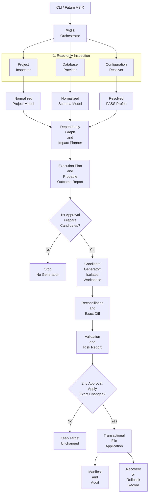

# PASS System Architecture

**Status:** Conceptual architecture; not implemented. For definitions of architectural concepts, technical abbreviations and PASS-specific terminology, refer to the [PASS Glossary and Technical Terminology](../Glossary.md).

## 1. Architectural objective

PASS is proposed as a .NET-based, project-aware orchestration system for database-first ASP.NET Core MVC scaffolding. It complements existing Microsoft tooling and coordinates project configuration, read-only inspection, dependency-impact analysis, generation planning, candidate creation, reconciliation, validation and approved application.

The CLI is the first planned interface. A Visual Studio extension may later call the same application services; it must not implement a separate generation engine.

## 2. Architectural invariants

1. Inspection and planning are read-only with respect to the target project and database.
2. A probable-outcome/impact plan must be presented before candidate code generation.
3. An authorized user must explicitly approve candidate preparation.
4. Candidate output is staged outside the target project and reviewed before application.
5. Applying candidate changes requires a separate explicit approval tied to the exact plan and candidate hashes.
6. No file, configuration, project, HTML/Razor, dependency or database change is silent, even when classified as low risk.
7. Ambiguous, unsupported or destructive conflicts stop the affected operation and are reported.
8. Database-first is the only initial source-of-truth mode. The live database is read-only and authoritative for database schema.
9. Rollback applies only to the exact approved transaction and its recorded backup/state.
10. Equivalent inputs and pinned versions should produce equivalent plans and candidate outputs.

## 3. High-level pipeline

## 4. Core stages

### 4.1 Read-only inspection

Inspect solution/project files, target frameworks, package references, naming/folder conventions, existing code and views, configuration, selected database metadata and previous PASS manifests. Do not write files, run migrations, alter schema or execute project generators at this stage.

### 4.2 Configuration resolution

Load the team's `pass.json`, validate it against the versioned schema, resolve defaults and explicit command overrides, and detect unsupported or conflicting settings. The `.csproj` and SDK configuration remain authoritative for target frameworks and build dependencies; `pass.json` expresses PASS generation preferences and policies.

### 4.3 Normalization and dependency graph

Convert inspected information into provider-neutral project/schema models. Build a graph of artifacts and relationships. Maintain forward and reverse dependency indexes so a change to any tracked item can identify the affected neighborhood.

### 4.4 Planning

Produce a plan containing the proposed scope, source fingerprints, detected changes, impacted artifacts, proposed actions, assumptions, probable outcome, risks, conflicts, required dependencies, validation strategy and rollback feasibility. This stage must not generate source files or mutate the target project/database.

### 4.5 Candidate preparation

Only after the first explicit approval, generate candidate artifacts in an isolated temporary workspace. Reconcile candidate outputs against recorded baselines and current files. Show the exact diff and run applicable static/build/test validation in the isolated workspace. Do not copy candidate files into the target project yet.

### 4.6 Application

Require a second explicit approval bound to the exact reviewed candidate hashes and operation list. Back up affected files, apply writes through a transaction journal, validate the applied state and record the result. If validation fails, perform only the rollback explicitly authorized in that approved transaction plan; otherwise stop and preserve the recovery material.

## 5. Source-of-truth policy

### Initial mode: database-first

- Live database schema is authoritative for table/view structure, columns, types, keys and relationships.
- `pass.json` is authoritative for PASS-specific generation preferences and approved policies.
- `.csproj`, `global.json`, central package files and existing build configuration are authoritative for project/build configuration.
- Generated entities and `DbContext` mappings are derived projections of the database schema.
- Controllers, view models, Razor views, scripts and tests are application artifacts dependent on schema, project conventions and explicit feature settings.
- EF Core migrations/model snapshots may be inspected to detect drift, but they do not silently override the live database in database-first mode.
- PASS must not execute DDL or apply EF migrations during ordinary scaffolding. It may prepare a proposed SQL script as a separately reviewed artifact when explicitly requested.

### Future mode: migrations-first

A future, separately selected mode may designate EF Core migrations/model snapshot as the schema authority and use a target database for drift detection. It must have separate rules for migration creation and script generation. Do not mix the two modes or automatically choose whichever representation happens to be newer.

### Disagreement

If the database schema, model snapshot, entity code and manifest disagree in a way that cannot be resolved under the selected authority, PASS must stop the affected operation, show the evidence and request a decision. It must not silently reconcile competing sources.

## 6. Project and runtime baseline

The initial implementation baseline is .NET 10 LTS. .NET 11 STS may be evaluated as a separate compatibility target. The exact SDK feature band, Visual Studio requirements, supported OS versions and package versions must be rechecked at implementation time. VSIX-specific projects may require a different target framework and must not be forced to inherit a universal target framework blindly.

## 7. Non-goals for the first implementation

- AI inference of business rules or business intent.
- Automatic database schema modification.
- Arbitrary, conflict-free merging of every possible C# or Razor customization.
- All database providers and all MVC architecture styles.
- Automatic alteration of authorization policy or security configuration.
- A claim that screenshots prove a functioning PASS implementation.
